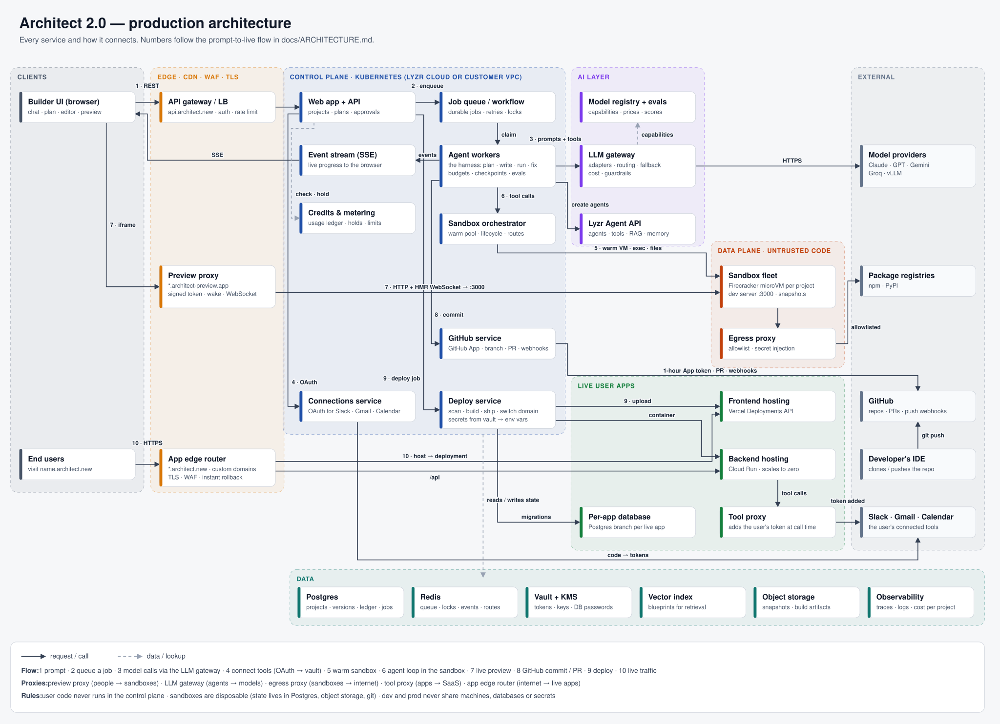
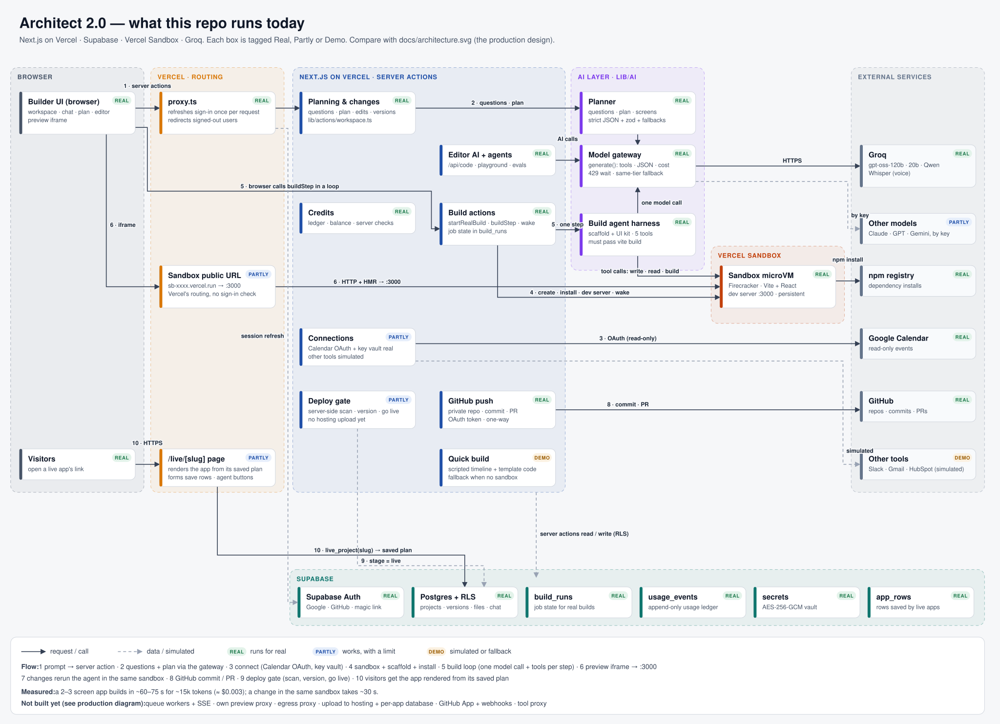
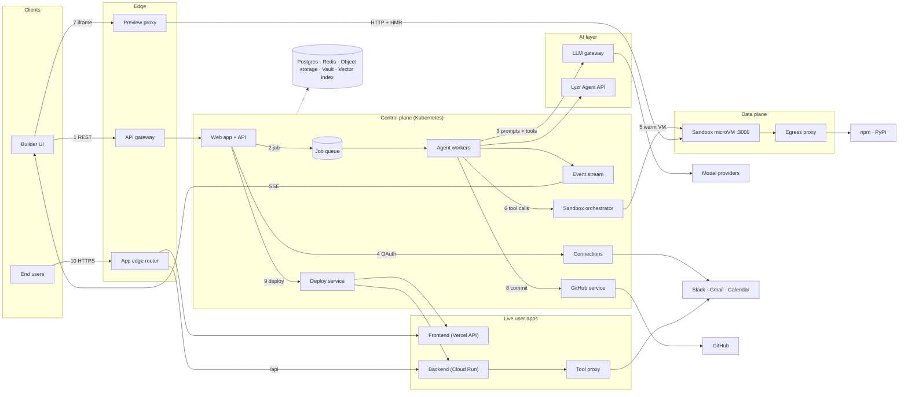

# Architect 2.0: Architecture

How Architect 2.0 would run as a production product: every service, why I picked it, and how a prompt becomes a live app. The last part maps this design onto what this repository already implements.



*Same diagram as a PNG: [architecture.png](./architecture.png). Numbers on the arrows follow [the flow below](#2-the-flow-from-prompt-to-live-app). For what this repo runs today, see [section 6](#6-what-this-repository-implements-today).*

---

## Contents

1. [Requirements and assumptions](#1-requirements-and-assumptions)
2. [The flow, from prompt to live app](#2-the-flow-from-prompt-to-live-app)
3. [Services: what each does and why](#3-services-what-each-does-and-why)
4. [Design decisions for each area of the brief](#4-design-decisions-for-each-area-of-the-brief)
   - [Sandboxes](#41-sandboxes)
   - [The agent harness](#42-the-agent-harness)
   - [Model-agnostic](#43-model-agnostic)
   - [Frontend ↔ sandbox ↔ backend, and the live preview](#44-frontend--sandbox--backend-and-the-live-preview)
   - [The proxies](#45-the-proxies)
   - [GitHub integration](#46-github-integration)
   - [Deploying user apps, and Architect itself](#47-deploying-user-apps-and-architect-itself)
   - [Scaling to thousands of users](#48-scaling-to-thousands-of-users)
5. [Build vs buy](#5-build-vs-buy)
6. [What this repository implements today](#6-what-this-repository-implements-today)
7. [Diagram as Mermaid](#7-diagram-as-mermaid)

---

## 1. Requirements and assumptions

**What it must do**
- Turn a prompt into a plan, then into a working app with AI agents inside it.
- Run AI-written code safely and show a live preview while it's being built.
- Connect the user's tools (Slack, Gmail, Google Calendar…) and let them choose AI models.
- Version every change, sync with GitHub, deploy to a real URL, roll back.
- Serve two people on one project: a **builder** who thinks in outcomes and a **developer** who reads code.

**Constraints that shape the design**
- **The code is untrusted.** An AI writes it and installs packages from the internet.
- **Scale and spikes.** Thousands of people building at once; launches bring 10× traffic in an hour.
- **Enterprise.** Lyzr customers may need the whole platform inside their own cloud (VPC) or on-prem.
- **Cost.** Model tokens dominate; idle compute must cost close to nothing.
- **Targets I'd set:** plan in < 30 s, first preview in < 2 min, deploy in < 90 s, 99.9% uptime for live apps.

**Four rules the design follows**
1. **The sandbox is disposable; the project is not.** Project state lives in Postgres, object storage and git. A sandbox can die at any time and be rebuilt.
2. **Anything slower than a second is a job.** Planning, building and deploying run on a queue; progress streams to the browser.
3. **User code never runs in the control plane** and never holds a real credential.
4. **Dev and prod never share** machines, databases or secrets.

---

## 2. The flow, from prompt to live app

The diagram has two halves that never mix:
- **Control plane:** our code. API, queue, agent workers, data stores, LLM gateway.
- **Data plane:** user code. Sandboxes for building and preview, hosting for live apps.

| # | User sees | Behind the scenes |
|---|---|---|
| **1** | Types a prompt and presses Enter; the project opens with "Planning…" | Browser → **API gateway** (auth, rate limit) → **API**. The API checks credits, runs an input guardrail (prompt injection), saves the project and first message in **Postgres**, and returns immediately. The browser opens an **SSE** stream for the project. |
| **2** | Clarifying questions, then the plan | The API puts a job on the **queue** with an idempotency key. An **agent worker** claims it and takes a per-project lock (one AI run at a time). The worker retrieves similar blueprints from the **vector index**. |
| **3** | (same) | The worker calls the model through the **LLM gateway**, asking for JSON that matches a schema: first the questions, then (after the user answers) the plan: screens, data model, agents, integrations needed, scope deferred to "later". The output is validated and streamed over SSE, and its cost is written to the usage ledger. |
| **4** | "Connect Slack" / "Use sample data" | The **connections service** runs OAuth with exactly the scopes the plan needs. Tokens are exchanged on our server, encrypted with **KMS** and stored in the **vault**. They never go to the browser, the sandbox or the generated code. |
| **5** | (on Approve: nothing visible, which is the point) | The API reserves credits and, in parallel, the **sandbox orchestrator** claims a microVM from a **warm pool** (booted from a template snapshot with dependencies installed, under 1 s). The worker creates the plan's agents in the **Lyzr Agent API**. |
| **6** | Files appear, a terminal scrolls, the build card ticks | **The agent loop.** The worker sends the model the plan, project rules, file tree and tools (read, write, edit, run, search, read logs, screenshot). Each tool call runs **inside the sandbox** via the orchestrator; its output goes back to the model. A QA step (build, type check, tests, headless click-through) must pass before the agent may finish. Events flow worker → **Redis** → SSE → browser. |
| **7** | The running app in the Preview tab, updating live | The dev server listens on **:3000** in the sandbox. The workspace iframe loads `p-123.architect-preview.app` → **preview proxy** → route lookup in Redis → signed-token check → wakes the sandbox if paused → forwards HTTP and the **hot-reload WebSocket** to :3000. |
| **8** | "Version 4 saved · pushed to GitHub" | Every passing build is a **checkpoint**: git commit in the sandbox, snapshot to **object storage**, a version row. The **GitHub service** pushes the commit to a working branch with a short-lived GitHub App token and opens or updates a PR. |
| **9** | A deploy checklist, then a public link | The **deploy service** runs a job:<br>1. Security scan.<br>2. Production build.<br>3. Frontend uploaded through the **Vercel Deployments API**, backend shipped as a container to **Cloud Run**.<br>4. A separate **per-app database** created and migrated.<br>5. Secrets copied from the vault into environment variables.<br>6. Health check, then the domain switches over. |
| **10** | Anyone can use the app | Visitors → **app edge router** (`name.architect.new` or a custom domain) → frontend; `/api` → Cloud Run. The app's tool calls go through the **tool proxy**, which adds the user's OAuth token at call time. Usage is metered to the owner. |

**Changes after the first build** repeat steps 6–8 on the same sandbox. The sandbox is resumed from its snapshot if it was idle, and the project lock keeps two changes from colliding.

---

## 3. Services: what each does and why

| Zone | Service | Responsibility | Why this choice |
|---|---|---|---|
| Edge | **API gateway / load balancer** | TLS, auth, rate limits, routing to the API | One choke point for abuse and auth before our code runs |
| Edge | **Preview proxy** | `*.architect-preview.app` → the right sandbox and port; signed-token access; wakes paused sandboxes; WebSocket upgrade for hot reload | Stable preview URLs, access control, and the freedom to switch sandbox providers |
| Edge | **App edge router** | `*.architect.new` and custom domains → the current deployment; TLS, cache, WAF | Deploys and rollbacks become a single routing change |
| Control | **Web app + API** | Projects, plans, approvals, versions, deploy requests | Stateless, so it scales horizontally |
| Control | **Event stream (SSE)** | Pushes live progress to the browser | One-way, works over plain HTTP, reconnects on its own with `Last-Event-ID` |
| Control | **Credits & metering** | Usage ledger, credit holds, per-org limits | Checks money on the server, before work starts |
| Control | **Job queue / workflow engine** | Durable jobs, retries, per-project locks | Crash-safe long work; a dead worker's job is resumed, not lost |
| Control | **Agent workers** | Run the agent harness (plan, write, run, fix) | Stateless; they scale with queue length |
| Control | **Sandbox orchestrator** | Warm pool, sandbox lifecycle, preview routes | The only code that knows the sandbox provider |
| Control | **Connections service** | OAuth flows, token refresh | Keeps every provider token off the client and out of user code |
| Control | **GitHub service** | GitHub App tokens, commits, PRs, webhooks | Two-way sync with least privilege |
| Control | **Deploy service** | Scan → build → host → database → secrets → health check → switch | One auditable pipeline with instant rollback |
| AI | **LLM gateway** | One interface for every provider: adapters, routing, fallbacks, retries, caching, cost, guardrails | Switching models is configuration, not code |
| AI | **Model registry + evals** | Each model's capabilities, price and eval scores | Only models that pass the evals for a role are offered |
| AI | **Lyzr Agent API** | The agents inside generated apps: tools, RAG, memory, guardrails | Reuses Lyzr's runtime instead of rebuilding it |
| Data | **Postgres** | Projects, versions, usage ledger, build jobs | Transactions and row-level security |
| Data | **Redis** | Queue, locks, live-event fan-out, preview routes | Fast, short-lived state |
| Data | **Object storage** | Sandbox snapshots, build artifacts | Large and cheap; a version is a pointer to a snapshot |
| Data | **Vault + KMS** | OAuth tokens, API keys, database passwords | Encrypted and access-logged |
| Data | **Vector index** | Blueprints and docs for retrieval | Grounds the planner in patterns that work |
| Data | **Observability** | Traces from API → job → model call → sandbox command; cost per project | Cost and slow builds are the main operational risks |
| Data plane | **Sandbox fleet** | One Firecracker microVM per project; dev server on :3000 | Kernel-level isolation for untrusted code |
| Data plane | **Egress proxy** | Outbound allowlist from sandboxes; secret injection | Untrusted code can't exfiltrate data or reach internal networks |
| Live apps | **Frontend hosting** (Vercel Deployments API) | Static and edge-rendered frontends, one project per user app | Global CDN, atomic deploys, automatic HTTPS |
| Live apps | **Backend hosting** (Cloud Run) | Containers for apps with servers or Python agents | Scales to zero, so idle apps cost nothing |
| Live apps | **Per-app database** | A Postgres branch or database per live app | Dev data never reaches production |
| Live apps | **Tool proxy** | Adds the user's OAuth token to the app's outbound tool calls | The app's code never holds tokens |

---

## 4. Design decisions for each area of the brief

### 4.1 Sandboxes

**Decision:** one **Firecracker microVM per project**, from a managed provider (Vercel Sandbox, E2B or Modal) behind our own orchestrator interface (`create · exec · writeFiles · expose(port) · snapshot · pause · resume`). Sandboxes are booted from **template snapshots** through a **warm pool**, and **paused when idle**.

**Why**
- **The code is untrusted.** A microVM has its own kernel; a container shares the host's, so one kernel bug could let code escape into another tenant.
- **Apps need real backends.** Lyzr apps run Python agents and databases, which rules out running the app in the user's browser.
- **Snapshots make it fast.** Firecracker boots in about 125 ms; with a warm pool, claiming a sandbox takes under a second.
- **Buy first.** Lovable cut its orchestration code from ~15,000 lines to ~700 by moving to Modal, and v0 runs a VM per chat on Vercel Sandbox. Sandboxes are not where we differentiate.
- **The interface is the exit door.** VPC and on-prem customers get the same interface over self-hosted Firecracker or Kata Containers on their Kubernetes.

**Lifecycle:** active → paused after ~15 idle minutes (memory and disk saved, resumes in ~1 s) → archived after days (rebuilt from the latest version).

**Rejected**
- **Docker containers:** shared kernel.
- **In-browser WebContainers:** no Python, no real servers.
- **A long-lived VM per user:** pays for idle time.

### 4.2 The agent harness

**Decision:** a **fixed workflow outside, one agent loop inside**. The stages are deterministic: plan → create agents → build loop → QA → checkpoint. Inside the build stage, a single coding agent loops over tools until the build and tests pass. It runs as a **durable job**.

**How it plans:** clarifying questions, then a plan as **JSON against a schema**. The output is validated and retried with the error if invalid. Retrieval over blueprints grounds it. The user approves before any code is written.

**How it writes code and runs tools**
- **Tools:** `list_files`, `read_file` (paged), `edit_file` (linted before it lands), `write_file`, `run`, `search`, `read_logs`, `screenshot`.
- **Every tool call is validated**, executed in the sandbox, and its output trimmed to what matters.
- **Context:** the plan, AGENTS.md rules and the file tree go in up front; files are read on demand; older turns are summarised as the context fills.

**How it recovers from errors**
- Build, type, test and browser-console errors are fed back as the next input.
- Retries are capped per error. After that, the harness rolls back to the last green checkpoint (a git commit) and asks the user a specific question.
- If a worker crashes, its heartbeat stops and another worker resumes the job from the last checkpoint.

**How it's kept healthy**
- **Budgets** on steps, tokens and minutes, tied to the credit hold.
- **Evals as a release gate:** a fixed set of real prompts scored on "it builds, tests pass, the click-through works", plus cost and time. Every prompt, tool or model change runs them.
- **Versioned prompts and tools**, rolled out gradually.
- **Traces per run**, so we can see build success rate, fix loops per app and cost per successful app.
- A **fast path** for small edits (text, colours) that skips the full loop.

**Rejected**
- **Many collaborating coding agents:** coding decisions depend on each other, and multi-agent setups cost far more tokens. Sub-agents are used only for read-only research.
- **One prompt that returns the whole app:** without a build in the loop, errors ship.

### 4.3 Model-agnostic

**Decision:** one internal model interface with **provider adapters** behind an **LLM gateway**, plus a **capability registry**, **prompt variants per model family**, and an **eval gate** before any model is offered.

**What breaks when you swap models**
- Tool-call and structured-output formats differ.
- Prompts tuned for one model family underperform on another.
- Context windows, vision support and allowed parameters differ.
- Small open models can't follow complex tool protocols.
- Cost and rate limits change.

**How it's handled**
- **Adapters** use each provider's native API: the official SDK for Claude, and one OpenAI-compatible adapter for Groq, OpenAI, Gemini and vLLM.
- **The gateway** owns keys, routing, retries, rate limits, prompt caching, cost per call and guardrails. A self-hostable gateway (e.g. LiteLLM) works inside a customer's VPC.
- **Every tool argument is validated**; errors go back to the model.
- **Fallback stays within a tier**, so a failing frontier model never silently drops to a much weaker one.

**Two meanings of "switching models"**
- **The builder's own models** are picked per role: a strong model for planning and coding, a fast one for autocomplete and small edits.
- **The model inside the user's app** is a field on its Lyzr agent. The generated code calls the Agent API, never a provider directly, so switching it needs no code change.

### 4.4 Frontend ↔ sandbox ↔ backend, and the live preview

The browser talks to the system through three channels:

| Channel | Used for | Why |
|---|---|---|
| **REST** | Commands: create, answer, approve, build, change, deploy | Each returns a job id immediately |
| **SSE** | Live progress events (`plan_delta`, `file_written`, `command_output`, `test_failed`, `version_saved`) | One-way, plain HTTP, auto-reconnect with `Last-Event-ID`; events are persisted so a reconnecting tab replays what it missed |
| **iframe via the preview proxy** | The running app | The browser never talks to the sandbox's control API; only workers do |

**How the preview works**
1. The dev server listens on :3000 inside the sandbox.
2. The workspace iframe loads `p-123.architect-preview.app`.
3. Wildcard DNS sends that host to the preview proxy, which forwards to the sandbox.
4. Hot reload runs over a WebSocket through the same proxy, so each saved file updates the preview in place.

**Two details that matter**
- **Previews live on a separate registrable domain**, so untrusted preview code can never read Architect's cookies. GitHub keeps user content on a separate domain for the same reason.
- **Comments on the preview:** a small script in dev builds tells the parent page which element was clicked (via `postMessage`), so the agent knows exactly what to change.

### 4.5 The proxies

A proxy is a middleman: it receives a request, decides where it goes, checks or changes it, and forwards it. Architect has three kinds of traffic, so it has three core proxies, plus two for live apps:

| Proxy | Sits between | Job |
|---|---|---|
| **Preview proxy** | Builder's browser → sandboxes | Map `p-123` to a sandbox and port (Redis), verify a signed short-lived token, wake paused sandboxes, upgrade WebSockets, terminate TLS with one wildcard certificate |
| **LLM gateway** | Agents → model providers | Keys, routing, fallbacks, rate limits, caching, cost logging, input and output guardrails |
| **Egress proxy** | Sandboxes → internet | Allowlist (package registries, the APIs the app needs), block internal networks and cloud metadata endpoints, inject secrets at the edge |
| **Tool proxy** | Live apps → Slack, Gmail… | Attach the user's OAuth token at call time |
| **App edge router** | Internet → live apps | Hostname → current deployment, TLS, caching, WAF, one-step rollback |

The preview proxy is a small stateless service (Envoy, a Go service or a Cloudflare Worker) that reads routes from Redis, so it scales horizontally.

### 4.6 GitHub integration

**Decision:** a **GitHub App** with two-way sync. Each passing build is committed to a **working branch** with a **pull request** kept open. `main` is never force-pushed. **Push webhooks** bring developers' own commits back.

**How it works**
1. The user installs the App on chosen repos; we store the installation id.
2. To push, the GitHub service signs a JWT with the App's private key and exchanges it for a **1-hour installation token** scoped to that repo.
3. It pushes with `git push` from the sandbox or through the Git Data API (blob → tree → commit → move the ref).
4. One branch per working session (`architect/session-12`) and one PR per branch; merges happen on GitHub.
5. When a `push` webhook arrives, the service verifies its HMAC signature and queues a sync job. The job pulls the commits into the sandbox and the version store, and tells the agent which files changed.
6. If both sides changed the same files, Architect's work goes to a side branch with a PR. It never silently overwrites.

**Why a GitHub App, not an OAuth App**
- The user picks which repos it can touch, and permissions are fine-grained.
- Tokens are short-lived and scoped to one repo.
- Webhooks are built in, and rate limits scale with installs.

### 4.7 Deploying user apps, and Architect itself

**The user's app: a pipeline that stops at the first failure**
1. **Security scan** on the server: hardcoded secrets, vulnerable packages, missing auth. High severity blocks.
2. **Production build** in the sandbox; the output is stored as an immutable artifact.
3. **Choose hosting by app shape:**
   - **Frontend only:** upload through the **Vercel Deployments API**, with one Vercel project per user app.
   - **Has a backend:** build a container image, push it to a registry, and deploy to **Cloud Run** (scales to zero). The frontend still goes to Vercel and calls the backend's URL through the edge router's `/api` route.
4. **Production database:** a separate database or Postgres branch per app, with migrations applied.
5. **Secrets** from the vault become environment variables on Vercel and Cloud Run; they are never written into code.
6. **Health check** the new deployment.
7. **Switch traffic** in one step: the edge router points `name.architect.new` (or the user's custom domain, added via a CNAME with automatic HTTPS) at the new deployment.
8. **Keep the previous deployment.** Rollback is pointing the domain back, in seconds and with no rebuild.

**Architect itself**

| Part | Choice |
|---|---|
| Compute | **Kubernetes** (EKS, AKS or GKE): separate deployments for the API, SSE server, workers, orchestrator, preview proxy and LLM gateway |
| Data | Managed Postgres (multi-AZ, point-in-time recovery), Redis, object storage, KMS + secrets manager |
| Edge | CDN + WAF; wildcard DNS for previews and user apps |
| Delivery | Terraform (infrastructure) + Helm (services); CI runs lint, tests and agent evals → staging → gradual production rollout |
| Observability | OpenTelemetry traces across API → job → model call → tool call; SLO alerts; cost per project |

**Why Kubernetes rather than one PaaS:** Lyzr sells VPC and on-prem deployments. One Helm chart that installs into a customer's AWS, Azure or GCP is a product requirement. Managed services keep operations small in our own cloud.

### 4.8 Scaling to thousands of users

**The bottleneck is model throughput, not servers.** A rough estimate for 2,000 people building at the same moment:

```
Sandboxes      2,000 × 2 vCPU                  = 4,000 vCPU   (managed providers offer 10k–50k concurrent per customer)
Model calls    2,000 runs × 1 call / ~15 s     ≈ 130 calls/s
Input tokens   130 × ~20k tokens               ≈ 2.6M tokens/s ≈ 160M tokens/min → far beyond one account's rate limit
```

**What I'd do**

*Queue and models*
- **Queue every agent run**, with priority by plan, concurrency caps per user and per org, and honest back-pressure ("you're second in line") instead of errors.
- **The gateway spreads load** across provider accounts and regions, falls back within a tier, uses prompt caching (most of each prompt repeats between steps), and sends simple steps to cheaper models.
- **Workers autoscale on queue depth** (e.g. KEDA). They're stateless.
- **Budgets** per run and per org stop runaway cost.

*Sandboxes, data and live apps*
- **Warm pools** are sized from forecasts per template; **idle sandboxes pause**; old ones are archived.
- **Postgres:** connection pooling, read replicas, and the high-volume `events` and `usage` tables partitioned by time.
- **Live apps** scale on their own hosting, isolated from builder load.
- **Cells:** past a certain size, shard tenants into independent copies of the stack, so one incident hits a slice of users. This maps cleanly to per-customer VPC installs.

**What I'd measure:** queue wait, time to first preview, build success rate, fix loops per app, cost per successful app, sandbox utilisation.

---

## 5. Build vs buy

| Component | Decision | Reason |
|---|---|---|
| Sandboxes | **Buy** (Vercel Sandbox / E2B / Modal), behind our interface | Hard to run well and not a differentiator; self-host only for on-prem or cost |
| LLM gateway | **Build a thin layer**, or adopt LiteLLM self-hosted | Must run inside a customer VPC; we own routing and cost data |
| Agent runtime for apps | **Reuse** the Lyzr Agent API / Studio | Model choice, guardrails, memory and RAG already exist |
| Harness, planner, QA | **Build** | This is the product: the quality of the apps it makes |
| Plan-first UX, builder/developer views | **Build** | Where users feel the difference |
| Evals | **Build** (on Lyzr's simulation engine) | The only safe way to ship model and prompt changes |
| App hosting | **Buy** (Vercel API + Cloud Run) | Commodity; we own the router and the pipeline |

---

## 6. What this repository implements today



*Each box is tagged **Real**, **Partly** or **Demo**. PNG: [architecture-current.png](./architecture-current.png).*

The repo (Next.js 16 on Vercel, Supabase, Vercel Sandbox) implements the core of this design in a smaller form. The real build agent was measured on a 2–3 screen app: **~60–75 s, ~15k tokens, about $0.003 of model cost**. A follow-up change (adding a search box) took **~30 s** in the same sandbox.

| Area | Implemented in this repo | Where |
|---|---|---|
| Plan-first flow | Real: clarifying questions and plan as validated JSON, with fallbacks | `lib/ai/planner.ts`, `lib/ai/llm.ts`, `lib/actions/workspace.ts` |
| LLM gateway | Real: one `generate()` for Groq, Claude (official SDK), OpenAI and Gemini; tool calls, JSON schemas, cost per call, 429 waits, same-tier fallback | `lib/ai/gateway.ts`, `lib/ai/models.ts` |
| Sandboxes | Real: Vercel Sandbox (Firecracker microVM) behind one file | `lib/sandbox.ts` |
| Agent harness | Real: Vite + React scaffold with a UI kit; 5 tools; history trimming; can't finish until `vite build` passes; changes rerun in the same sandbox | `lib/ai/builder.ts`, `lib/actions/build.ts` |
| Jobs | Partly: job state in `build_runs`, resumable after a reload. **The browser drives the steps** instead of a queue worker; the step function is the same one a worker would call | `lib/actions/build.ts`, `supabase/migrations/0006_metering_builds.sql` |
| Live preview | Real: dev server on :3000, shown in an iframe via the sandbox's public URL; paused sandboxes are woken on open. **No own preview proxy yet** | `components/workspace/sandbox-preview.tsx`, `wakePreview` |
| Credits | Real: append-only usage ledger; balance = $20 + bonus − real spend; server-side checks before AI work | `lib/usage.ts`, `lib/usage-log.ts` |
| Security | Real: row-level security on every table, AES-256-GCM vault, a pre-deploy scan enforced on the server | `supabase/migrations/`, `lib/secret-box.ts`, `lib/security-scan.ts` |
| GitHub | Real commits: private repo, Git Data API, branch + PR, never forced. **OAuth token, one-way** (not yet a GitHub App with webhooks) | `lib/actions/github.ts` |
| Connections | Google Calendar OAuth and the vault are real; other providers' consent is simulated | `components/connect/`, `lib/actions/secrets.ts` |
| Deploy | Server-side security gate and versioning are real. **The live URL renders the app from its saved plan**: no Vercel/Cloud Run upload or per-app database yet | `deploy()` in `lib/actions/workspace.ts`, `app/live/[slug]` |
| Architect's own hosting | Vercel + Supabase (not Kubernetes) | — |

**Next steps, in order**
1. A deploy pipeline that ships the sandbox build to Vercel (and Cloud Run when needed), with its own database.
2. A queue worker driving `buildStep`, with SSE to the browser.
3. Warm sandboxes from a template snapshot, claimed when the plan is approved.
4. Our own preview proxy with signed tokens on a separate domain.
5. An egress allowlist for sandboxes.
6. A GitHub App with webhooks.
7. Real OAuth for every tool, through a connections service and a tool proxy.

---

## 7. Diagram as Mermaid

A simplified version that GitHub renders inline:


